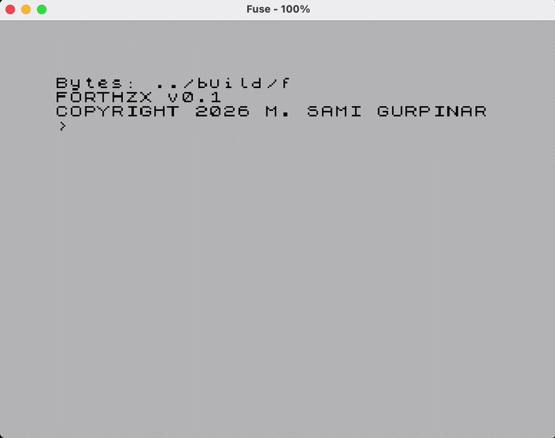

# forthZX
A Forth interpreter for the Sinclair ZX Spectrum, written in Z80 Assembly. 

forthZX explores stack-based language interpretation on 8-bit hardware by using the Z80's native hardware stack as the Forth data stack, eliminating the need for a separate software-managed data stack.

Download the `TAP` file from [itch.io](https://xms0g.itch.io/forthzx).



## Architecture

forthZX uses the Z80's native hardware stack (SP) as its Forth data stack, avoiding a separate software-managed data stack.

Stack operations are implemented directly using Z80 instructions such as PUSH and POP.

Since the hardware stack is also used for return addresses, the interpreter carefully manages stack usage. In particular, the parser avoids subroutine calls to prevent return-address operations from interfering with Forth data.

This approach keeps the implementation close to the underlying Z80 architecture while exploring the constraints of implementing a stack-oriented language on 8-bit hardware.

|Command|ZX Spectrum Key|PC Key|
|-|-|-|
|`+`|SYMBOL_SHIFT + K|CONTROL + K|
|`-` |SYMBOL_SHIFT + J|CONTROL + J|
|`*` |SYMBOL_SHIFT + B|CONTROL + B|
|`/`| SYMBOL_SHIFT + V|CONTROL + V|
|`.`| SYMBOL_SHIFT + M|CONTROL + M|
|`:`| SYMBOL_SHIFT + Z|CONTROL + Z|
|`=`| SYMBOL_SHIFT + L|CONTROL + L|
|`>`| SYMBOL_SHIFT + T|CONTROL + T|
|`<`| SYMBOL_SHIFT + R|CONTROL + R|
|`DUP`|-|-|
|`DROP`|-|-|
|`SWAP`|-|-|
|`OVER`|-|-|
|`ROT`|-|-|
|`EMIT`|-|-|
|`AND`|-|-|
|`OR`|-|-|
|`INVERT`|-|-|
|`.S`|-|-|

Press SYMBOL SHIFT or CONTROL only once when entering special characters.

## Building
```bash
make
```

## License
This project is licensed under the BSD 3-Clause License. See the LICENSE file for details.

